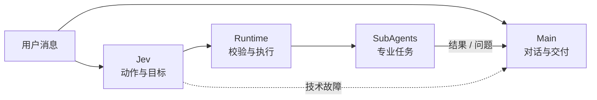
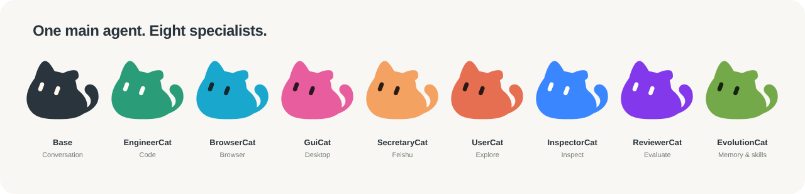

<div align="center">
  <picture>
    <source media="(prefers-color-scheme: dark)" srcset="assets/xiaoba-logo-dark.png">
    
  </picture>

# XiaoBa

**有记忆，会做事，能跟进。**

一个本地优先的开源个人 Agent。和它持续对话，让专业角色接手代码、网页、桌面和飞书工作，把结果、文件与提醒带回原对话。

[](https://github.com/fightheyyy/XIAOBA/releases) [](package.json) [](LICENSE)

[快速开始](#快速开始) · [工作方式](#对话与执行各司其职) · [实验结果](#用实验检验架构) · [English](docs/README.en.md)

</div>

## 从对话到执行

| 你交代的事 | XiaoBa 如何承接 |
| --- | --- |
| “看看这个项目为什么构建失败，修好后跑一遍验证。” | EngineerCat 检查代码、修改文件并运行验证，Main 汇总改动与结果。 |
| “帮我查资料。你先查，我继续说说需求。” | BrowserCat 在后台工作；你可以继续聊天、追加约束、查询进度或停止任务。 |
| “明天下午提醒我；以后这个项目按这个偏好处理。” | 提醒按会话保存；写入成功的偏好保存在可查看、可编辑的本地 Markdown 中。 |

从 **CLI、飞书、微信或桌面**进入，各入口复用同一套会话管理、工具执行和交付机制。模型可选 OpenAI-compatible、Anthropic 或本地 Ollama；角色依赖与 Skill 按需安装。

## 对话与执行，各司其职

XiaoBa 把用户交流、任务选择和实际执行拆开。启用 **Jev V2** 后，Main 与 Jev 同时处理用户消息：Main 负责对话与交付，Jev 选择动作和目标，Runtime 校验后执行。



Main 可以先回应，无需等路由完成；派发、查询、停止、调整和恢复由 Runtime 统一执行，操作结果以真实执行事实为准。子任务完成或提出问题后，直接回到 Main。

**Jev 是可选能力。** 未配置或遇到技术故障时，同一 Session 恢复原 Main 的调度方式。所有 Role 继续复用同一套 XiaoBa Agent loop；提醒、Connector 与显式 Base Skill 保留原有入口。

## 快速开始

### 从源码运行

需要 **Node.js ≥ 22.12**。以下命令适用于 macOS / Linux shell；Windows 可手动复制配置文件。

```bash
git clone https://github.com/fightheyyy/XIAOBA.git
cd XIAOBA
npm ci
cp .env.example .env
```

在 `.env` 中填写你的模型配置：

```env
XIAOBA_LLM_PROVIDER=openai
XIAOBA_LLM_API_BASE=https://api.openai.com/v1
XIAOBA_LLM_API_KEY=your_api_key
XIAOBA_LLM_MODEL=your_model
```

检查环境，开始对话：

```bash
npm run dev -- doctor
npm run dev -- chat -i
```

要启用 Jev，在同一文件中加入：

```env
XIAOBA_JEV_API_KEY=your_jev_key
```

当前默认通过 OpenCode 调用 `jev-1.13-free`。模型、地址、总时限和重试配置见 [`.env.example`](.env.example)；留空密钥即使用原 Main。

<details>
<summary>桌面、飞书、微信与安装包</summary>

```bash
# 桌宠与对话窗口
npm run dev -- pet

# Electron Dashboard
npm run electron:dev

# 飞书 / 微信入口
npm run dev -- feishu
npm run dev -- weixin
```

各入口仍需相应账号、登录与权限。BrowserCat、GuiCat、SecretaryCat 的依赖见 [Driver 安装说明](docs/requirements.txt)；EngineerCat 的 `codex_run` 需要单独登录，见 [角色指南](roles/README.md)。

桌面预览包见 [Releases](https://github.com/fightheyyy/XIAOBA/releases)，平台安装方式与签名状态以对应发布说明为准。安装包与当前源码可能不同步，Jev V2 以源码为准。桌面运行若找不到系统 Node，可用 `XIAOBA_NODE_EXE` 指定绝对路径。


截图供布局参考，当前猫形与配色见角色图。

</details>

## 专业分工，共享一个 Runtime

你始终和一个 XiaoBa 对话。**Base Main** 负责沟通、理解返回材料并交付；专业 Role 各自执行职责内的工作。

| 角色 | 职责 |
| --- | --- |
| **EngineerCat** | 实现、修复和验证代码；可通过 `codex_run` 使用官方 Codex SDK。 |
| **BrowserCat** | 浏览器操作、资料获取与页面验证。 |
| **GuiCat** | macOS 桌面 GUI 操作。 |
| **SecretaryCat** | 通过官方 `lark-cli` 处理飞书工作流；`FeishuCat` 是别名。 |
| **UserCat** | 在 Arena 中模拟用户，探索使用场景。 |
| **InspectorCat** | 从 Trace 中提取有证据的问题与可执行 Case。 |
| **ReviewerCat** | 依据 Case、Oracle 与执行证据，在硬检查之后做语义判断。 |
| **EvolutionCat** | 维护长期记忆，改进 Role / Skill / Memory。 |

前四个角色接手实际工作，后四个支持评测与改进，按需参与。Base 默认没有预装 Skill；可以显式安装独立 Skill。权限和使用方法见 [Roles](roles/README.md) 与 [Skills](skills/README.md)。

<details>
<summary>看看这支小猫团队</summary>



</details>

## 连接你使用的应用

原生 Connector 通过官方 API 接入 **Gmail、Notion 和 GitHub**，由 Base 主会话使用：读取邮件与页面、处理文档、查看仓库和 PR，或执行已确认的写入。

在 Dashboard 的「应用连接」中配置 Token 或 Gmail OAuth。发送邮件、创建内容等写入先展示完整参数提案，等待用户确认；凭据通过本地配置管理。飞书由 SecretaryCat 使用独立登录的 `lark-cli` 接入。详见 [应用连接指南](roles/README.md#agent-自有应用连接)。

## 用实验检验架构

Jev V2 的对照包含 **30 个场景 × A/B × 3 次重复，共 180 次真实场景运行**。Main、Jev 和 SubAgent 均真实调用模型；文件与工具执行也真实发生。

| 观测指标 | 原 Main | Main + Jev |
| --- | ---: | ---: |
| 平均 Main token¹ | 22,557 | 15,090（−33.1%） |
| 平均 Main + Jev token¹ | 22,557 | 25,090（+11.2%） |
| 首条可见回复 P50² | 12.98s | 5.07s |
| Jev 预期动作 / 目标匹配 | — | 90/90 |

¹ 使用 89 对完整用量记录，child token 另计。总 token 与费用分别核算，成本按模型定价情景估算。

² 两组可见交付为 80/90、86/90，分母不同；首条回复可能是确认或错误拒绝，不等于正确答复或任务完成时间。尚未证明独立语义质量或生产性能提升。

[完整结果与限制](docs/evaluation/PLAN.md) · [脱敏观测](eval/benchmarks/jev-v2/2026-11-02.json) · [题集](eval/benchmarks/jev-v2/suite.json) · [实验脚本](scripts/run-jev-v2-live.ts)

安装依赖后，可在本地复算统计与价格情景，**不调用模型**：

```bash
node --import tsx scripts/run-jev-v2-live.ts --summarize eval/benchmarks/jev-v2/2026-11-02.json
```

## 执行可查，改进先验收

模型调用、工具结果、文件、交付与失败进入 Trace；用户实际看到的消息另存为 Conversation Journal。会话、记忆与执行证据默认保存在本地；使用外部模型时，请求内容仍会发给配置的服务。

真实问题可以转成可重放的 Case，再生成候选改动。**工程测试检查代码，行为评测检查目标是否完成。** 候选复用 Test + Eval，通过后在新 Session 或下一进程生效；失败或 blocked 保留当前版本。

```text
Trace / Case → 候选改动 → Test + Eval → 验收后激活
```

<details>
<summary>开发者：测试、评测与观测配置</summary>

```bash
npm test
npm run test:base-runtime
npm run test:check-scripted-runtime

# 真实 Agent CaseSet；默认只读 Replay
npm run dev -- eval run --case-set eval/case-sets/xiaoba-core-readonly.json

# 场景探索与受控改进
npm run dev -- arena evaluate --role engineer-cat --scenario "帮我修好这个项目"
npm run dev -- evolution sleep
```

Verifier 做硬检查，ReviewerCat 做语义判断，一次执行只有一个 `pass / fail / blocked`。工程测试通过不代表所有真实任务已验收。模块合同与当前进度见 [Evaluation](docs/evaluation/SPEC.md)、[Arena](docs/arena/SPEC.md) 与 [Project PLAN](docs/PLAN.md)。

可选 OTLP/HTTP 导出通过 `XIAOBA_OBSERVABILITY_ENABLED=true` 和 `OTEL_EXPORTER_OTLP_ENDPOINT` 启用，不导出 prompt、工具参数或文件内容。可见聊天可在配置 `CATENA_BASE_URL` 和 `CATENA_API_KEY` 后同步到 Catena。

Logo 与角色图由产品共享 Canvas renderer 生成，更新命令为 `npm run assets:readme`；需要可用 Chromium，见 [生成脚本](scripts/generate-readme-assets.mjs)。

</details>

## 当前边界

- 仍处于 Preview。Jev V2 已接入代码，真实任务、对话质量与生产容量尚未全部验收；已知问题与回归状态见 [验证记录](docs/evaluation/PLAN.md)。
- 记忆按会话和角色隔离，跨入口用户身份尚未统一；提醒与主动检查依赖对应服务在线，CLI 重新打开时处理到期提醒。
- GuiCat 仅支持 macOS；BrowserCat 和飞书工作流需要各自的 Driver、登录和权限。
- 统一文件 / Shell 沙箱接入 macOS 和 Linux；Windows 受限执行返回 blocked。写入型 Case 需要显式声明 `workspace_write` 并在隔离 Runtime 中运行。
- Dashboard、Pet 和 Bridge 面向本机使用，不可信网络下的完整认证与 Owner 授权尚未完成。

[架构](docs/SPEC.md) · [项目进度](docs/PLAN.md) · [配置示例](.env.example) · [Issues](https://github.com/fightheyyy/XIAOBA/issues) · [Discussions](https://github.com/fightheyyy/XIAOBA/discussions)

[Apache-2.0](LICENSE)
