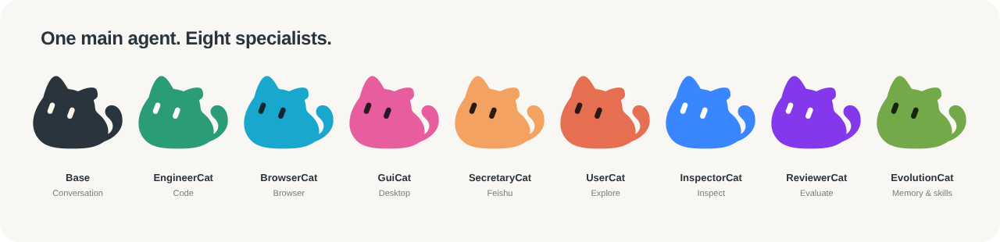
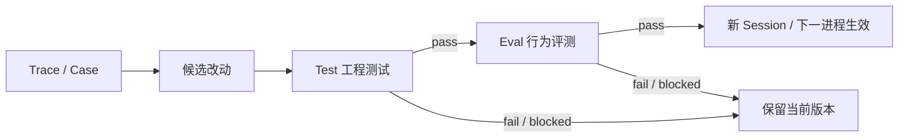

<div align="center">
  <picture>
    <source media="(prefers-color-scheme: dark)" srcset="assets/xiaoba-logo-dark.png">
    
  </picture>

# XiaoBa

**有记忆、会跟进、能做事的开源 Personal Agent。**

持续和它对话，让它记住你的偏好，接手任务，并按约定提醒和跟进。通过 CLI、飞书、微信或桌面使用，结果、文件和提醒回到发起工作的对话中。

[](https://github.com/fightheyyy/XIAOBA/releases) [](package.json) [](LICENSE)

[角色协作](#一只小猫一支团队) · [Connector](#应用连接connector) · [受控进化](#受控进化) · [快速开始](#快速开始) · [English](docs/README.en.md)

</div>

## 你的 Personal Agent

**记住上下文和偏好。** 会话可以恢复，稳定偏好可保存为本地 Markdown，并在后续请求中读取；记忆文件可以查看和修改。

**按约定回来跟进。** 设置稍后提醒或定时检查，让 XiaoBa 在原对话里提醒你、检查进展并返回结果。

**接手实际工作。** 代码、浏览器、macOS 桌面与飞书工具由专业角色执行，XiaoBa 负责沟通和派工，把结果与文件带回来。猫形的眼神和动作会随运行状态变化。

**由你选择模型和能力。** 会话、记忆与运行证据默认保存在本地；可接入 OpenAI-compatible、Anthropic 或本地 Ollama。外部模型仍会按配置接收请求内容。角色依赖和独立 Skill 按需安装，见 [Roles](roles/README.md) 与 [Skills](skills/README.md)。

### 可以交给它的工作

| 你想做的事 | 怎么完成 | 你会拿到什么 |
| --- | --- | --- |
| 修改代码、修复问题、跑构建 | 修改文件并运行验证 | 代码改动、验证结果与生成的文件 |
| 浏览网页、收集资料、核验页面 | 操作浏览器并检查页面 | 整理后的结果、来源与页面证据 |
| 操作 macOS 桌面应用 | 通过桌面 Driver 执行操作 | 操作结果与界面证据 |
| 处理飞书消息、日历、任务与文档 | 调用已授权的飞书 CLI | 飞书侧结果、文件与交付回执 |

## 一只小猫，一支团队



你只需和 XiaoBa 对话，它会按任务调动专业角色。**Base** 负责沟通、派工与结果汇总；八个专业 Role 复用同一套 XiaoBa Agent loop，分别承担执行、评测和改进。

| 角色 | 分工 |
| --- | --- |
| **EngineerCat** | 代码实现与修复；可通过 `codex_run` 调用官方 Codex SDK |
| **BrowserCat** | 浏览器操作与页面验证 |
| **GuiCat** | macOS 桌面 GUI 操作 |
| **SecretaryCat** | 通过官方 `lark-cli` 执行飞书工作流；`FeishuCat` 是别名 |
| **UserCat** | 在 Arena 中模拟用户、探索场景 |
| **InspectorCat** | 从 Trace 中提取有证据的问题和可执行 Case |
| **ReviewerCat** | 在硬检查之后，根据 Case 和证据做语义判断 |
| **EvolutionCat** | 维护长期记忆，改进 Role / Skill / Memory |

前四个角色负责执行任务，后四个参与内部评测与改进；它们不会在每次任务中全部顺序执行。角色权限、工具与安装方法见 [Roles Guide](roles/README.md)。

## 应用连接：Connector

连接应用后，XiaoBa 可以读取获授权的信息，并通过工具完成操作。当前原生 Connector 使用 Gmail、Notion 和 GitHub 的官方 API。

| 应用 | 已实现的能力 |
| --- | --- |
| **Gmail** | 搜索邮件、读取正文与线程、管理标签、创建草稿与发送邮件 |
| **Notion** | 搜索和读取已分享页面、查询数据源、创建或更新页面、追加区块 |
| **GitHub** | 读取仓库、Issue、PR、文件与 Actions 状态；创建或更新 Issue、发表评论、从已有分支创建 PR |

在 Dashboard 的「应用连接」中配置 GitHub / Notion Token 或 Gmail OAuth。连接由 Base 主会话使用；发送邮件、创建内容等写入操作先展示参数提案，确认后执行。凭据通过本地配置管理，不需要发进聊天。

飞书工作流由 SecretaryCat 通过官方 `lark-cli` 接入，继续使用独立的 CLI 登录。配置与权限说明见 [应用连接指南](roles/README.md#agent-自有应用连接)。

## 受控进化

真实使用中的问题可以转成可重放的 Case，再生成候选改动。候选能力先经过测试与评测，通过后才激活；失败或 blocked 保留当前版本。



- **交付可查。** Trace 记录模型调用、工具结果、文件、交付与失败；用户可见的聊天另存为 Conversation Journal。
- **结果可重放。** Replay 用 Case 驱动当前 Agent，Verifier 做硬检查，ReviewerCat 做语义判断；一次执行只有一个 `pass / fail / blocked` 结果。
- **改进先验收。** Evolution 从 Trace / Case 生成 Candidate，复用 Test + Eval；通过后，能力更新在新 Session 生效，代码更新在下一进程生效。失败或 blocked 保持当前版本。

Arena 负责从 Scenario 出发探索问题，再把 Case 交给共享 Eval。具体合同和当前进度见 [Evaluation](docs/evaluation/SPEC.md)、[Arena](docs/arena/SPEC.md) 与 [Project PLAN](docs/PLAN.md)。

<details>
<summary>开发者：测试、评测与可观测性</summary>

```bash
npm test
npm run test:base-runtime
npm run test:check-scripted-runtime

# 真实 Agent CaseSet，默认只读 Replay
npm run dev -- eval run --case-set eval/case-sets/xiaoba-core-readonly.json

# 场景探索与受控改进
npm run dev -- arena evaluate --role engineer-cat --scenario "帮我修好这个项目"
npm run dev -- evolution sleep
```

本地 `traces.jsonl` 是运行证据来源。可选 OTLP/HTTP 导出通过 `XIAOBA_OBSERVABILITY_ENABLED=true` 和 `OTEL_EXPORTER_OTLP_ENDPOINT` 启用；不会导出 prompt、工具参数或文件内容。可见聊天可在同时配置 `CATENA_BASE_URL` 和 `CATENA_API_KEY` 后同步到 Catena。

静态 Logo 和角色图直接调用产品的共享 Canvas renderer 生成：

```bash
npx playwright install chromium
npm run assets:readme
```

已安装系统 Chromium 时，可用 `XIAOBA_CHROMIUM_PATH` 指定路径。生成器输出透明背景的静态 PNG Logo 与角色配色图；深色主题使用带浅色细描边的 Logo。

</details>

## 快速开始

### 从源码运行

需要 **Node.js ≥ 22.12**。以下命令适用于 macOS / Linux shell；Windows 可手动复制 `.env.example` 为 `.env`。

```bash
git clone https://github.com/fightheyyy/XIAOBA.git
cd XIAOBA
npm install
cp .env.example .env
```

在 `.env` 中配置模型，例如：

```env
XIAOBA_LLM_PROVIDER=openai
XIAOBA_LLM_API_BASE=https://api.openai.com/v1
XIAOBA_LLM_API_KEY=your_api_key
XIAOBA_LLM_MODEL=your_model
```

选择一个入口：

```bash
# 先检查模型、角色、Driver 和平台配置
npm run dev -- doctor

# CLI 对话
npm run dev -- chat -i

# 桌宠与对话窗口
npm run dev -- pet

# Electron Dashboard
npm run electron:dev
```

BrowserCat、GuiCat、SecretaryCat 的外部依赖与权限见 [Driver 安装说明](docs/requirements.txt)。EngineerCat 的 Codex 执行器需要单独登录，见 [角色使用指南](roles/README.md)。

### 下载桌面预览版

[**v0.2.2 Preview**](https://github.com/fightheyyy/XIAOBA/releases/tag/v0.2.2) 提供 [macOS Apple Silicon DMG](https://github.com/fightheyyy/XIAOBA/releases/download/v0.2.2/XiaoBa-0.2.2-mac-arm64.dmg) 和 [Windows x64 安装包](https://github.com/fightheyyy/XIAOBA/releases/download/v0.2.2/XiaoBa-0.2.2-win.exe)。Logo 展示的是当前源码中的新造型，已有安装包不会随源码自动更新。

macOS 包采用 ad-hoc 签名、未 notarize；Windows 包未签名。预览包的桌面子服务仍依赖系统 Node.js，当前源码要求 Node.js ≥ 22.12。若桌面无法找到 Node，可通过 `XIAOBA_NODE_EXE` 指定可执行文件的绝对路径。

<details>
<summary>展开查看 Dashboard 预览</summary>


现有 Dashboard 截图供布局参考；猫形与角色配色以当前 Logo 和上方角色图为准。

</details>

## 当前支持范围

- 记忆按会话和角色范围隔离，跨入口的用户身份尚未统一。提醒与主动检查依赖对应服务运行；CLI 重新打开时会处理到期提醒。
- GuiCat 桌面接管仅支持 macOS；BrowserCat 和飞书工作流需要相应 Driver、登录与权限。
- 当前源码的统一文件 / Shell 沙箱接入 macOS 和 Linux；Windows 的受限执行会返回 blocked。写入型 Case 需要显式声明 `workspace_write` 并在隔离 Runtime 中运行。
- Dashboard、Pet 和 Bridge 主要面向本机使用；不可信网络下的完整认证与 Owner 授权尚未完成。
- Preview 自动更新默认关闭，新桌面版本通过 [Releases](https://github.com/fightheyyy/XIAOBA/releases) 手动安装。

## 继续了解

[架构](docs/SPEC.md) · [进度与验证](docs/PLAN.md) · [角色](roles/README.md) · [技能](skills/README.md) · [配置示例](.env.example) · [Issues](https://github.com/fightheyyy/XIAOBA/issues) · [Discussions](https://github.com/fightheyyy/XIAOBA/discussions)

[Apache-2.0](LICENSE)
