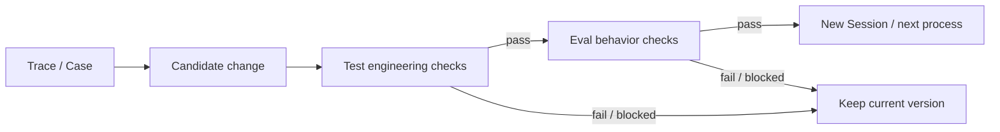

<div align="center">
  <picture>
    <source media="(prefers-color-scheme: dark)" srcset="../assets/xiaoba-logo-dark.png">
    
  </picture>

# XiaoBa

**An open-source personal agent with memory, tools, and follow-up.**

Keep a conversation going, save your preferences, delegate tasks, and agree on reminders and follow-ups. Use the CLI, Feishu, Weixin or desktop; results, files and reminders return to the conversation where the work began.

[](https://github.com/fightheyyy/XIAOBA/releases) [](../package.json) [](../LICENSE)

[Role collaboration](#a-little-cat-a-whole-team) · [Connectors](#app-connections-connectors) · [Governed evolution](#governed-evolution) · [Quick start](#quick-start) · [简体中文](../README.md)

</div>

## Your personal agent

**Remember context and preferences.** Sessions can be restored. Stable preferences can be saved as local Markdown and loaded into later requests; you can inspect and edit the memory files.

**Come back when agreed.** Set reminders or scheduled checks so XiaoBa can return to the original conversation, check progress and bring back results.

**Take on real work.** Specialist Roles execute code, browser, macOS desktop and Feishu tasks. XiaoBa handles conversation and dispatch and brings back results and files. Its cat's eyes and movements reflect runtime state.

**Choose your model and capabilities.** Sessions, memory and execution evidence stay local by default. Connect OpenAI-compatible, Anthropic or local Ollama models; external models still receive request content according to your configuration. Install Role dependencies and standalone Skills as needed; see [Roles](../roles/README.md) and [Skills](../skills/README.md).

### Work you can delegate

| What you need | How it gets done | What comes back |
| --- | --- | --- |
| Change code, fix a bug, run a build | Edit files and run verification | Code changes, verification results and generated files |
| Browse sites, collect research, verify pages | Operate the browser and check pages | Organized results, sources and page evidence |
| Operate macOS desktop applications | Execute actions through the desktop Driver | Action results and interface evidence |
| Handle Feishu messages, calendars, tasks and docs | Use the authorized Feishu CLI | Results in Feishu, files and delivery receipts |

## A little cat, a whole team


Talk to XiaoBa and it dispatches specialist Roles as needed. **Base** owns conversation, dispatch and bringing results together. Eight specialist Roles share the XiaoBa Agent loop and handle execution, evaluation and improvement.

| Role | Responsibility |
| --- | --- |
| **EngineerCat** | Implement and repair code; call the official Codex SDK through `codex_run` |
| **BrowserCat** | Operate and verify browser pages |
| **GuiCat** | Operate macOS desktop interfaces |
| **SecretaryCat** | Run Feishu workflows through the official `lark-cli`; `FeishuCat` is an alias |
| **UserCat** | Simulate users and explore scenarios in Arena |
| **InspectorCat** | Extract evidenced problems and executable Cases from traces |
| **ReviewerCat** | Judge Case results against evidence after hard checks |
| **EvolutionCat** | Maintain long-term memory and improve Roles, Skills and Memory |

The first four Roles execute tasks; the other four support internal evaluation and improvement. They do not all run sequentially on every request. See the [Roles Guide](../roles/README.md) for permissions, tools and setup.

## App connections: Connectors

Connect apps so XiaoBa can read authorized information and act through tools. Native Connectors currently use the official Gmail, Notion and GitHub APIs.

| App | Implemented capabilities |
| --- | --- |
| **Gmail** | Search mail, read messages and threads, manage labels, create drafts and send mail |
| **Notion** | Search and read shared pages, query data sources, create or update pages and append blocks |
| **GitHub** | Read repositories, Issues, PRs, files and Actions status; create or update Issues, post comments and open PRs from existing branches |

Configure GitHub / Notion tokens or Gmail OAuth in the Dashboard's **Connectors** page. Base main sessions use these connections. Writes such as sending mail or creating content show a parameter proposal and execute after confirmation. Credentials are managed through local configuration rather than chat.

SecretaryCat accesses Feishu through the official `lark-cli`, with its own CLI login. See the [app connection guide](../roles/README.md#agent-自有应用连接) for setup and permissions.

## Governed evolution

Problems from real use can become replayable Cases and candidate changes. Candidates pass tests and evaluation before activation; failure or blocked evaluation preserves the current version.



- **Inspectable delivery.** Traces record model calls, tool results, files, deliveries and failures. User-visible messages are stored separately in a Conversation Journal.
- **Replayable results.** Replay runs a Case against the current Agent. Verifier performs hard checks, then ReviewerCat judges meaning; each execution has one `pass / fail / blocked` outcome.
- **Verified improvements.** Evolution produces Candidates from traces or Cases and reuses Test + Eval. Passing capability updates take effect in new Sessions; code updates take effect in the next process. Failure or blocked evaluation preserves the current version.

Arena explores Scenarios and sends Cases to the shared Eval. Contracts and current progress live in [Evaluation](evaluation/SPEC.md), [Arena](arena/SPEC.md) and the [Project PLAN](PLAN.md).

<details>
<summary>Developers: tests, evaluation and observability</summary>

```bash
npm test
npm run test:base-runtime
npm run test:check-scripted-runtime

# Real Agent CaseSet; Replay is read-only by default
npm run dev -- eval run --case-set eval/case-sets/xiaoba-core-readonly.json

# Scenario exploration and governed improvement
npm run dev -- arena evaluate --role engineer-cat --scenario "Fix this project"
npm run dev -- evolution sleep
```

Local `traces.jsonl` remains the source of execution evidence. Optional OTLP/HTTP export uses `XIAOBA_OBSERVABILITY_ENABLED=true` and `OTEL_EXPORTER_OTLP_ENDPOINT`; prompt text, tool arguments and file contents are excluded. Visible conversations can sync to Catena when both `CATENA_BASE_URL` and `CATENA_API_KEY` are configured.

The static logo and Role illustration render the product's shared Canvas player directly:

```bash
npx playwright install chromium
npm run assets:readme
```

For an existing system Chromium installation, set `XIAOBA_CHROMIUM_PATH` to its executable. The generator outputs transparent static PNG logos and the Role illustration. Dark themes use a logo with a thin light outline.

</details>

## Quick start

### Run from source

Requires **Node.js ≥ 22.12**. These commands use a macOS / Linux shell; on Windows, copy `.env.example` to `.env` manually.

```bash
git clone https://github.com/fightheyyy/XIAOBA.git
cd XIAOBA
npm install
cp .env.example .env
```

Configure a model in `.env`, for example:

```env
XIAOBA_LLM_PROVIDER=openai
XIAOBA_LLM_API_BASE=https://api.openai.com/v1
XIAOBA_LLM_API_KEY=your_api_key
XIAOBA_LLM_MODEL=your_model
```

Choose an entry point:

```bash
# Check the model, Roles, Drivers and platform configuration
npm run dev -- doctor

# CLI conversation
npm run dev -- chat -i

# Desktop pet and conversation window
npm run dev -- pet

# Electron Dashboard
npm run electron:dev
```

BrowserCat, GuiCat and SecretaryCat require external dependencies and permissions: see [Driver setup](requirements.txt). EngineerCat's Codex executor requires a separate login; see the [Roles Guide](../roles/README.md).

### Download the desktop preview

[**v0.2.2 Preview**](https://github.com/fightheyyy/XIAOBA/releases/tag/v0.2.2) provides a [macOS Apple Silicon DMG](https://github.com/fightheyyy/XIAOBA/releases/download/v0.2.2/XiaoBa-0.2.2-mac-arm64.dmg) and a [Windows x64 installer](https://github.com/fightheyyy/XIAOBA/releases/download/v0.2.2/XiaoBa-0.2.2-win.exe). The logo shows the updated design in the current source; existing installers do not update when source changes.

The macOS build is ad-hoc signed and not notarized; the Windows build is unsigned. Preview desktop child services require system Node.js; current source requires Node.js ≥ 22.12. If the desktop cannot locate Node, set `XIAOBA_NODE_EXE` to its absolute executable path.

<details>
<summary>Show the Dashboard preview</summary>


This existing screenshot shows the Dashboard layout. The logo and Role illustration above show the current cat design and colors.

</details>

## Current support

- Memory is scoped to sessions and Roles; cross-surface user identity is not unified. Reminders and proactive checks depend on the corresponding service running; reopening the CLI processes due reminders.
- GuiCat desktop takeover is macOS-only. BrowserCat and Feishu workflows require their respective Drivers, login and permissions.
- The current source integrates the shared file / Shell sandbox on macOS and Linux. Restricted execution on Windows returns blocked. Write-enabled Cases must explicitly declare `workspace_write` and run in an isolated Runtime.
- Dashboard, Pet and Bridge primarily target local use; complete authentication and Owner authorization for untrusted networks are pending.
- Preview auto-update is disabled by default. Install desktop updates manually from [Releases](https://github.com/fightheyyy/XIAOBA/releases).

## Keep exploring

[Architecture](SPEC.md) · [Progress and verification](PLAN.md) · [Roles](../roles/README.md) · [Skills](../skills/README.md) · [Configuration](../.env.example) · [Issues](https://github.com/fightheyyy/XIAOBA/issues) · [Discussions](https://github.com/fightheyyy/XIAOBA/discussions)

[Apache-2.0](../LICENSE)
