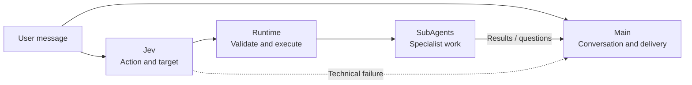
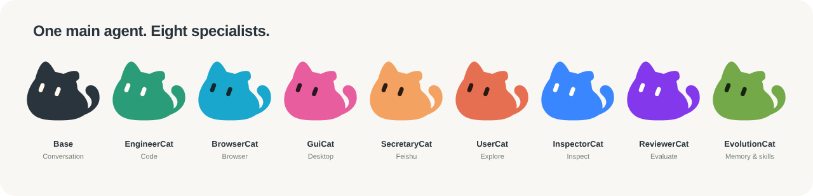

<div align="center">
  <picture>
    <source media="(prefers-color-scheme: dark)" srcset="../assets/xiaoba-logo-dark.png">
    
  </picture>

# XiaoBa

**Memory, action, and follow-through.**

An open-source personal agent that runs locally. Keep a conversation going, delegate code, browser, desktop and Feishu work, and receive results, files and reminders in the conversation where the work began.

[](https://github.com/fightheyyy/XIAOBA/releases) [](../package.json) [](../LICENSE)

[Quick start](#quick-start) · [How it works](#conversation-and-execution-with-clear-ownership) · [Measurements](#test-the-architecture) · [简体中文](../README.md)

</div>

## From conversation to execution

| What you ask | How XiaoBa handles it |
| --- | --- |
| “Find out why this project fails to build. Fix it and verify the change.” | EngineerCat inspects and edits the code, runs verification, and returns findings to Main. |
| “Research this while I explain the rest of the requirements.” | BrowserCat works in the background. You can keep talking, add constraints, check progress or stop the task. |
| “Remind me tomorrow afternoon, and use this preference for the project.” | Reminders are stored per session. Preferences successfully saved to memory live in local Markdown that you can inspect and edit. |

Use the **CLI, Feishu, Weixin or desktop**. Each entry point reuses the same session-management, tool-execution and delivery mechanisms. Choose OpenAI-compatible, Anthropic or local Ollama models; install Role dependencies and Skills as needed.

## Conversation and execution, with clear ownership

XiaoBa separates user interaction, task selection and execution. With **Jev V2** enabled, Main and Jev start in parallel: Main handles conversation and delivery, Jev selects an action and target, and Runtime validates and executes it.



Main can respond before routing finishes. Runtime owns spawn, check, stop, steer and resume; action reports must reflect actual execution facts. Child results and questions return directly to Main.

**Jev is optional.** Missing configuration or a technical failure restores Legacy Main dispatch within the same Session. All Roles reuse the XiaoBa Agent loop. Reminders, Connectors and explicitly installed Base Skills keep their existing entry points.

## Quick start

### Run from source

Requires **Node.js ≥ 22.12**. These commands use a macOS / Linux shell; on Windows, copy the configuration file manually.

```bash
git clone https://github.com/fightheyyy/XIAOBA.git
cd XIAOBA
npm ci
cp .env.example .env
```

Configure your model in `.env`:

```env
XIAOBA_LLM_PROVIDER=openai
XIAOBA_LLM_API_BASE=https://api.openai.com/v1
XIAOBA_LLM_API_KEY=your_api_key
XIAOBA_LLM_MODEL=your_model
```

Check the environment and start a conversation:

```bash
npm run dev -- doctor
npm run dev -- chat -i
```

To enable Jev, add a key to the same file:

```env
XIAOBA_JEV_API_KEY=your_jev_key
```

The current default calls `jev-1.13-free` through OpenCode. See [`.env.example`](../.env.example) for model, endpoint, total deadline and retry settings. Leave the key empty to use Legacy Main.

<details>
<summary>Desktop, Feishu, Weixin and installers</summary>

```bash
# Desktop pet and conversation window
npm run dev -- pet

# Electron Dashboard
npm run electron:dev

# Feishu / Weixin entry points
npm run dev -- feishu
npm run dev -- weixin
```

Each entry point needs its accounts, login and permissions. See [Driver setup](requirements.txt) for BrowserCat, GuiCat and SecretaryCat dependencies. EngineerCat's `codex_run` requires a separate login; see the [Roles Guide](../roles/README.md).

Desktop previews are available under [Releases](https://github.com/fightheyyy/XIAOBA/releases). Refer to each release for platform installation and signing status. Installers may lag behind source; use source for Jev V2. If the desktop cannot locate system Node, set `XIAOBA_NODE_EXE` to its absolute executable path.


The screenshot illustrates the layout. The Role illustration shows the current cat design and colors.

</details>

## Specialist work, one shared Runtime

You talk to one XiaoBa. **Base Main** handles conversation, interprets returned evidence and delivers results; specialist Roles work within their own responsibilities.

| Role | Responsibility |
| --- | --- |
| **EngineerCat** | Implement, repair and verify code; access the official Codex SDK through `codex_run`. |
| **BrowserCat** | Operate the browser, gather information and verify pages. |
| **GuiCat** | Operate macOS desktop interfaces. |
| **SecretaryCat** | Run Feishu workflows through the official `lark-cli`; `FeishuCat` is an alias. |
| **UserCat** | Simulate users and explore scenarios in Arena. |
| **InspectorCat** | Extract evidenced problems and executable Cases from traces. |
| **ReviewerCat** | Judge Case outcomes against the Oracle and execution evidence after hard checks. |
| **EvolutionCat** | Maintain long-term memory and improve Roles, Skills and Memory. |

The first four Roles execute work; the other four support evaluation and improvement as needed. Base ships with no default Skills; standalone Skills can be explicitly installed. See [Roles](../roles/README.md) and [Skills](../skills/README.md) for permissions and usage.

<details>
<summary>Meet the cats</summary>



</details>

## Connect your apps

Native Connectors use official **Gmail, Notion and GitHub** APIs from Base main sessions: read messages and pages, work with documents, inspect repositories and PRs, and execute confirmed writes.

Configure tokens or Gmail OAuth in the Dashboard's **Connectors** page. Writes such as sending mail or creating content show the full parameter proposal and wait for user confirmation. Credentials are managed through local configuration. SecretaryCat uses `lark-cli` with a separate login for Feishu. See the [app connection guide](../roles/README.md#agent-自有应用连接).

## Test the architecture

The Jev V2 comparison covers **30 scenarios × A/B × 3 repeats: 180 real scenario executions**. Main, Jev and SubAgents use real model calls; file operations and tool execution are real too.

| Observed metric | Legacy Main | Main + Jev |
| --- | ---: | ---: |
| Mean Main tokens¹ | 22,557 | 15,090 (−33.1%) |
| Mean Main + Jev tokens¹ | 22,557 | 25,090 (+11.2%) |
| First visible reply P50² | 12.98s | 5.07s |
| Jev expected action / target matches | — | 90/90 |

¹ Uses 89 pairs with complete usage; child tokens are reported separately. Token counts and monetary cost are separate measures; cost is estimated under explicit pricing scenarios.

² Visible delivery counts differ: A 80/90, B 86/90. A first reply can be an acknowledgment or an incorrect refusal, not a correct answer or task completion. Independent semantic quality and production performance improvements remain unproven.

[Results and limitations](evaluation/PLAN.md) · [Sanitized observations](../eval/benchmarks/jev-v2/2026-11-02.json) · [Suite](../eval/benchmarks/jev-v2/suite.json) · [Harness](../scripts/run-jev-v2-live.ts)

After installing dependencies, recompute the statistics and pricing scenarios locally, **without model calls**:

```bash
node --import tsx scripts/run-jev-v2-live.ts --summarize eval/benchmarks/jev-v2/2026-11-02.json
```

## Inspect execution. Verify improvements.

Traces record model calls, tool results, files, deliveries and failures. User-visible messages live separately in a Conversation Journal. Sessions, memory and execution evidence stay local by default; requests still go to external model services when configured.

Problems from real use can become replayable Cases and candidate changes. **Engineering tests check code; behavior evaluation checks whether a goal was met.** Candidates reuse Test + Eval and activate in a new Session or the next process after passing. Failure or blocked evaluation preserves the current version.

```text
Trace / Case → Candidate change → Test + Eval → Activation after acceptance
```

<details>
<summary>Developers: tests, evaluation and observability</summary>

```bash
npm test
npm run test:base-runtime
npm run test:check-scripted-runtime

# Real Agent CaseSet; read-only Replay by default
npm run dev -- eval run --case-set eval/case-sets/xiaoba-core-readonly.json

# Scenario exploration and governed improvement
npm run dev -- arena evaluate --role engineer-cat --scenario "Fix this project"
npm run dev -- evolution sleep
```

Verifier performs hard checks, then ReviewerCat judges meaning; each execution has one `pass / fail / blocked` outcome. Passing engineering tests does not establish acceptance for every real task. Contracts and current progress live in [Evaluation](evaluation/SPEC.md), [Arena](arena/SPEC.md) and the [Project PLAN](PLAN.md).

Optional OTLP/HTTP export uses `XIAOBA_OBSERVABILITY_ENABLED=true` and `OTEL_EXPORTER_OTLP_ENDPOINT`; prompt text, tool arguments and file contents are excluded. Visible conversations can sync to Catena when `CATENA_BASE_URL` and `CATENA_API_KEY` are configured.

The logo and Role illustration use the product's shared Canvas renderer. Run `npm run assets:readme` to update them; it requires a working Chromium installation. See the [generator](../scripts/generate-readme-assets.mjs).

</details>

## Current boundaries

- This is a Preview. Jev V2 is implemented, but real tasks, conversation quality and production capacity are not fully accepted. See the [verification record](evaluation/PLAN.md) for known issues and regression status.
- Memory is scoped to sessions and Roles; cross-surface user identity is not unified. Reminders and proactive checks need the corresponding service online; reopening the CLI processes due reminders.
- GuiCat is macOS-only. BrowserCat and Feishu workflows need their Drivers, login and permissions.
- The shared file / Shell sandbox integrates with macOS and Linux. Restricted execution on Windows returns blocked. Write-enabled Cases must explicitly declare `workspace_write` and run in an isolated Runtime.
- Dashboard, Pet and Bridge target local use; complete authentication and Owner authorization for untrusted networks are pending.

[Architecture](SPEC.md) · [Project progress](PLAN.md) · [Configuration](../.env.example) · [Issues](https://github.com/fightheyyy/XIAOBA/issues) · [Discussions](https://github.com/fightheyyy/XIAOBA/discussions)

[Apache-2.0](../LICENSE)
