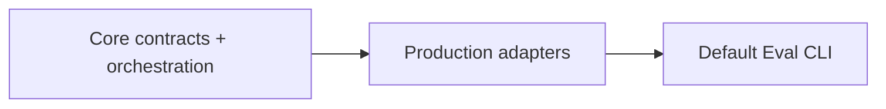

# Evaluation PLAN

状态：Active
最后更新：2026-11-02
Owner：Runtime / Evaluation maintainers

## Current Status

Jev Router V2（2026-11-02，Owner: Evaluation，真实对照完成、生产验收部分通过）：30 场景×A/B×3，共 180 次场景运行，不是 180 次模型调用。Main/child 固定 gpt-5.6-luna(low)，Jev 为 jev-1.13-free。所有 setup 有效，无 provider 错误，1 条 Main 后续请求超时且 usage 不完整。公开数据在 `eval/benchmarks/jev-v2/2026-11-02.json`，题集与脚本一同维护；离线复算命令和计量合同见配套 SPEC。

| 指标 | 原 Main A | Main + Jev B | 口径 |
| --- | --- | --- | --- |
| 平均 Main token | 22556.79 | 15090.45 | 89 对完整记录，-33.1% |
| 平均 Main + Jev token | 22556.79 | 25090.46 | 同 89 对，+11.2%；child 另列 |
| 首条可见回复 P50 | 12.98s | 5.07s | 各组已交付样本，描述性差异 -60.9% |
| 最后可见回复 P50 | 14.87s | 10.88s | 描述性差异 -26.8%，不是正确完成时间 |
| 可见交付 | 80/90 | 86/90 | 延迟分母不同，不能作等交付因果收益 |
| Jev 预期动作/目标匹配 | — | 90/90 | 不等于任务成功或生产可靠性 |
| 自动动作检查 | 87/90 | 88/90 | 保留已知澄清正则漏判，不称端到端正确率 |
| 任务硬检查 | 72/90 | 74/90 | 非独立语义质量裁决，不证明明显提升 |

费用是按 2026-11-02 单价快照的 API 等价估算，不是实际扣费。Main/child 使用输入 $0.20/M、缓存输入 $0.02/M、输出 $1.20/M；包括请求后已有任务继续执行，排除请求前 setup。官方价来源在公开数据 pricing_snapshot；$0.0252/M 只是未验证的折扣情景。89 对完整记录折算每千次请求：

| Jev 输入价格情景（输出免费） | A 总模型费用 | B 总模型费用 | 估算差异 |
| --- | --- | --- | --- |
| 免费型号 $0/M | $3.8044 | $3.0944 | -18.66% |
| 官方付费 $0.042/M | $3.8044 | $3.4204 | -10.09% |
| 假设折扣 $0.0252/M | $3.8044 | $3.2900 | -13.52% |

| 场景分组（每组样本数） | 自动动作检查 A / B | 任务硬检查 A / B |
| --- | --- | --- |
| 聊天及等待期无动作（30） | 30/30 / 30/30 | 21/30 / 25/30 |
| 提醒查询（3） | 3/3 / 3/3 | 3/3 / 3/3 |
| 单 Role（24） | 24/24 / 24/24 | 24/24 / 21/24 |
| 信息问题桥（3） | 3/3 / 3/3 | 3/3 / 3/3 |
| Check / Stop / Steer / Resume（12） | 12/12 / 12/12 | 11/12 / 12/12 |
| 歧义/复杂请求（6） | 3/6 / 4/6 | 3/6 / 4/6 |
| 多 Role 并行（6） | 6/6 / 6/6 | 6/6 / 5/6 |
| 多 Role 顺序（6） | 6/6 / 6/6 | 1/6 / 1/6 |

B 六条顺序链均按预期 Role 顺序，且前阶段结束后才启动后阶段；链条启动正确不表示目标完成。JV2-15 的 B 三次均由 Reviewer 返回 blocked；JV2-26-B-3 也返回 blocked 却通过有限硬检查。Jev 选中了预期 Role，后续执行有退化；上下文构造、Role/Skill 和模型行为的影响未分离，不把根因直接定为 Runtime。JV2-30-A-3/B-2/B-3 是已知澄清漏判，原始分数不改写。费用降低也不能解释为等质量、等交付条件下的效率收益。

主实验 Main 曾过早拒绝派工；后来补本轮 Runtime 接收状态上下文，另做 3 题×A/B×1 的 6 次复验。人工查看 3 个 B 样本未再错误拒绝，Reviewer blocked 仍如实保留；这些样本与源码哈希在公开数据 followup，未替换主实验或宣称最终版本重跑 180 次。早期诊断/代理异常运行排除原因在公开数据中保留，实际账号仍有额度，重启本地代理后恢复原模型。

源码基线为 7bb56f1，测量时工作树不干净，含本次不合并的既有沙箱修复；精确源码快照保留在本地分析 ZIP，公开 hash 标识版本，当前检出不能冒充当时的精确 Runtime。原测量工作区整仓 768/775，7 个失败在其隔离基线复现；本次独立发布分支构建、脚本类型检查及 23/23 定向检查通过；整仓 763/776，无沙箱修复的干净 HEAD 基线为 739/753，13 个失败均在基线复现（基线另有 1 个已修正的旧提示断言失败）。日志保留在本地 output/test/jev-v2/publish-{focused,full-regression,baseline-regression}.log，不宣称整仓全绿。技术 Jev 故障、取消、防重、越权由工程测试注入，不当作自然故障率。下一步复核对话质量及硬检查适用范围；没有真实 IM/Pet、原生打包、外部账号写入、生产容量或独立语义盲评证据。

Main/Jev 对照实验（2026-11-02，Owner: Evaluation，实验已完成，未接生产）：题集与脱敏观测已整理至 `eval/benchmarks/jev-parallel/`，方法与命令由配套 SPEC 持有。20 题每组一次有效运行；两组路由均 20/20。平均 Main token 16201→11341，含 Jev 16201→12158；10 条执行题首条可见回复均值 11.41→6.13 秒、最后可见回复 11.41→9.33 秒。全题首个模型响应均值 4.01→4.54 秒，没有模型推理加速证据。

普通聊天首个 Main 请求 token 5519→4573，但平均模型调用次数 1.4→1.8，交付率 4/10→8/10；全程含 Jev token 7714→9063，不能据此判断等交付条件下的聊天效率。全题交付 A 14/20、B 18/20；mock 来源表述的问题不等同于生产虚报完成。4 条 fixture 无效观测和 1 条中断样本已排除并记录原因。下一步：统一交付条件和路由 prompt，再验证真实子任务；本轮没有故障降级或真实任务完成率证据。公开数据保留工作树不干净、单次小样本、恢复打断交错顺序和 provider/cache 波动的限制，不能宣称生产收益。发布前验证：在干净基线的独立工作树中，5/5 离线测试、实验脚本及项目 TypeScript 检查、diff 检查通过；没有重跑模型请求或整仓 gate。

根目录资源迁移已实现；路径与兼容行为见配套 SPEC，验证结果统一记录在仓库 PLAN。

源码目录迁移完成（2026-10-23）：Replay、Harbor 与工程验证支持已归位；Agent Eval 公共入口与 Scripted Runtime Test 仍分开。合同 smoke 与 Harbor 桥接通过；旧子 Agent Scripted 场景的基线失败记录在仓库 PLAN。 验证结果见仓库 PLAN 的 Recent Verification；本模块尚未完成的功能里程碑保持原状态。

- Test / Eval / Trace / Case / Replay 的语义边界已确定。
- `npm test` 的 `pretest` 自动执行构建，支持无 dist 的干净检出；内部 Source Candidate 流程保持先独立构建、再直接调用 run-tests 的顺序。
- 轻量 `Case + Oracle → Replay → Trace → Verifier → ReviewerCat → Outcome` 核心已实现并测试。
- Case Replay adapter 已能驱动当前 Pet/Agent Runtime，并且只返回 fresh Trace ref；生产默认通过隔离子进程执行。
- ReviewerCat Judge adapter 使用独立只读 Session 和结构化输出。
- Outcome 只保留 `pass | fail | blocked`；EvaluationResult 只保存事实。
- BaseRuntime 预写响应已迁到 `test/scripted-runtime/**`、`src/eval/testing/**` 和 `output/test/**`。
- Scripted Runtime Test engine 已隔离在 `src/eval/testing/**`；`src/eval/index.ts` 只导出真实 Agent Eval。
- 真实 CaseSet CLI 已接入；Verifier registry 保持为 `trace_exists`、`no_failed_tools` 与 `read_only_tools` 三项。
- 首个维护中的 `xiaoba-core-readonly-v1` 已建立，包含 Base、EngineerCat、ReviewerCat 三条真实 Agent Case。
- Replay 默认只读；`workspace_write` 必须显式声明并由 enforced clean runtime 承载，外部 delivery / Browser / GUI / Secretary 工具不进入 Replay。
- Arena 默认命令与 nightly Evolution 已调用同一个 Evaluation core。
- VibeLifeBench Harbor P0 adapter 已实现；真实官方任务验收 blocked，未获得有效评分。

## Milestones

1. 明确 Test / Eval / Replay 边界：completed。
2. 实现轻量 Evaluation core：completed。
3. 实现 ReviewerCat shared Judge adapter：completed。
4. 实现 Case Replay adapter：completed。
5. 将 Scripted Runtime Test 移出 Eval 公共语义：completed。
6. 接入最小生产 Verifier registry：completed；后续按真实 Case 需求扩展。
7. 提供真实 CaseSet CLI：completed。
8. 将旧 Eval-named Test engine 与 Agent Eval 公共入口隔离：completed；物理位置为 `src/eval/testing`。
9. 建立首个维护中的真实 CaseSet：completed。
10. 建立 Replay effect isolation：completed for default read-only and SDK clean-runtime workspace-write; unsupported hosts fail closed。

## Next Steps

- P0 仅补齐容器构建的代理 CA 信任和可用模型凭据后，重跑原样官方 `private_lending_33d`；不优化得分或扩展架构。
- 只在真实 Case 需要时增加新的 hard Verifier，避免搬回旧巨型 verifier registry。
- 用真实回归逐步扩充当前 CaseSet，不先造 benchmark taxonomy。
- 只在实际维护相关代码时逐步收敛 `src/eval/testing/**` 内部旧 `Eval*` 类型名，不单独发起机械改名。

## Owners

- Shared Eval：`src/eval/evaluation.ts`
- Reviewer Judge：`src/eval/reviewer-cat-judge.ts`
- Replay：`src/eval/replay/**`
- Scripted Runtime Test：`src/eval/testing/**`, `test/scripted-runtime/**`

## Acceptance Criteria

- 预写模型响应永远不被报告为 Agent Eval。
- Replay 驱动真实 Agent、产生 fresh Trace，且不输出 pass/fail。
- Replay 缺省只暴露只读工具；写入模式必须在 enforced clean runtime 中执行。
- 每个 execution 只有一个 Outcome。
- Verifier hard failure 否决 Reviewer pass。
- ReviewerCat fresh、只读、结构化，且看到同 Case 的全部 runs。
- Arena 和 Evolution 调用同一个 Evaluation runner。
- Report 和可选 Gate 不产生第二份权威 Result。

## Risks / Open Questions

- `workspace_write` uses the shared SDK on supported Linux/macOS hosts; missing isolation fails closed。
- 当前维护 CaseSet 只有三条只读 Case，尚不代表广泛 Agent 能力。
- 旧 Test engine 的内部类型仍带少量 `Eval*` 名称；它们已被限制在 `src/eval/testing/**`，后续随实际修改逐步收敛。

## Recent Verification

- 2026-10-21 VibeLifeBench P0：`npm run build` passed；Runtime/Event/Memory/ToolManager/Eval 相关回归 82/82 passed（含新增连续性与失败传播 2 项）；Python↔真实 Node worker↔Harbor environment Shell/MCP 桥接测试 1/1 passed。原样官方 collector 成功读取该工程测试 ATIF，识别 system 通知及实际桥接调用结果，未混入前步调用。上述预写模型响应均非 Agent 能力或官方得分证据；Trace 保留在 `output/test/harbor-bridge/`。
- 真实命令、版本与输出合同见配套 SPEC。`output/harbor/p0-private-lending-final/` 保留最终代码的实际 Harbor Result 与异常日志；官方 world-controller Docker build 安装 `mcp==1.25.0` 时遇到代理 CA `CERTIFICATE_VERIFY_FAILED`，Agent/Verifier 尚未启动，未产生该 trial 的 XiaoBa Trace 或官方 reward。当前模型 API Key 未配置，亦阻塞后续真实推理。不能将 job 汇总 mean=0 当作得分。
- `npm run build` passed。
- 清理后 `npm test` passed 556/556 across 100 suites。
- Scripted Runtime Test focused tests passed 45/45。
- Contract smoke passed 23/23。
- `npm run test:base-runtime -- --allow-fail` passed 11/11。
- `npm run test:check-scripted-runtime` passed 1 manifest / 11 cases。
- Source Candidate、Replay isolation 与 maintained CaseSet focused tests passed 22/22 across 6 suites。
- 旧 `src/eval` Test engine 路径引用检查为零，`git diff --check` passed。

## Unified sandbox execution

Owner: Evaluation / Runtime. Completed: Source Candidate build, ordinary tests and native-contract phase use shared SDK isolation; no candidate test code is launched directly on the host. Replay keeps its explicit workspace_write gate. Linux source-fixture build/test and shared SDK boundaries passed. Full verification and unsupported-platform limits are in `../agent-runtime/PLAN.md`.
