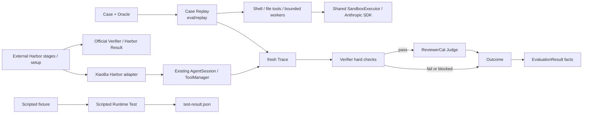
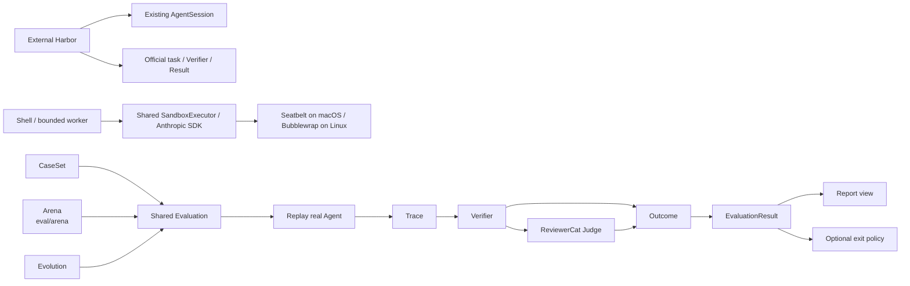

# Evaluation SPEC

状态：Active
最后更新：2026-10-23
适用范围：Test、Case Replay、Agent Eval、Verifier、ReviewerCat Judge。

本文是 XiaoBa-CLI `Evaluation` 模块的唯一架构真相源。

## Problem

工程正确性和 Agent 行为能力不是同一件事：

- Test 验证代码、Runtime、Tool、协议和安全约束是否按实现工作。
- Eval 验证真实 Agent 面对任务时能否完成，以及成功率、稳定性、安全性和成本。
- Trace 是两者共享的运行证据。
- Case 是两者可共享的可执行输入。
- Replay 只执行 Case 并产生新 Trace，不负责裁决。

任何预写模型响应或工具调用序列都只能叫 `Scripted Runtime Test`，不能作为 Agent 行为能力证据。

## Scope

In scope:

- `src/eval/evaluation.ts` 的 Case、Oracle、Outcome 和 EvaluationResult。
- `src/eval/replay/case-replay.ts` 的真实 Runtime Replay adapter。
- `src/eval/reviewer-cat-judge.ts` 的共享语义 Judge。
- Verifier hard checks、重复运行和事实聚合。
- `src/eval/testing/**` 与 `test/scripted-runtime/**` 的 Test 语义边界。
- `eval/harbor/agent.py` 与 `src/eval/harbor/session.ts` 的外部 Harbor P0 适配。

Out of scope:

- Trace 的持久化和脱敏，属于 Observability & Evidence。
- UserCat 场景探索，属于 Arena。
- Candidate 生成与激活，属于 Roles & Skills 的 Evolution 控制 DAG。
- 把 Report、Gate 或 Dashboard 状态作为第二套裁决。

## Current Architecture

Source Candidate 从既有 docs/scripts/skills 目录复制归位后的说明、依赖清单与索引资源，根文件清单不再包含已迁移资源和废弃 .gitmodules。

`src/eval/` 是验证代码的物理归属：根目录保留 shared Agent Eval，`replay/` 驱动真实执行，`arena/` 做场景探索，`harbor/session.ts` 是外部 Harbor Node 桥接，`testing/` 明确隔离确定性工程验证与 Candidate Test 支持。`testing/` 不从 Agent Eval 公共入口导出，预写模型响应仍不属于 Agent 能力证据。根目录 `eval/` 保存 CaseSets 和外部评测适配资产；`test/` 保存工程测试和 scripted fixtures。

轻量 Eval 核心已经实现。`runEvaluation` 默认每个 Case 运行三次；每次 Replay 都必须产生 fresh Trace，Verifier 硬失败直接形成 Outcome，硬检查通过后才由独立只读 ReviewerCat Session 做语义判断。状态只有 `pass | fail | blocked`。

旧的预写响应 runner 仍作为内部兼容实现存在，但公共入口已迁到 `src/eval/testing`，命令和产物统一使用 Scripted Runtime Test 语义。`xiaoba eval run --case-set <file>` 已直接组合真实 Case Replay、最小 hard Verifier registry 和 ReviewerCat Judge；当前 registry 只内置 `trace_exists`、`no_failed_tools` 与 `read_only_tools`。首个维护中的 `eval/case-sets/xiaoba-core-readonly.json` 包含三条不预写模型响应的真实 Agent Case。

Replay 默认使用 `read_only` policy，只向被测 Agent 暴露 `read_file`、`glob` 和 `grep`。Case 可以显式声明 `workspace_write`，但该模式只有在 Arena/Evolution 提供 enforced clean runtime 时才开放工作区文件与 Shell 工具；外部消息、Browser、GUI 和 Secretary 工具不属于 Replay 能力集。

VibeLifeBench P0 是外部 Harbor Agent 适配，不经过内部 Case Replay。Harbor 拥有官方多阶段任务、setup/world mutation、容器生命周期、evidence collection 和 Verifier；官方 Result 是该 Benchmark 的唯一评分。宿主 Python 适配器持有一个 Node 进程，同一 `AgentSession` / `ConversationRunner` 跨步骤持续运行。ToolManager 只注册任务 MCP tools 和通过 Harbor `environment.exec` 执行的容器 Shell，文件操作也在容器 `/workspace` 进行；不暴露宿主 Shell、真实 App Connector、Role 或 Subagent。MCP 客户端使用官方任务容器已有的 Python SDK，不增加 npm 依赖。



## Target Architecture

源码职责沿用以上目录边界；保持单一 Runtime、既有权限和证据合同，继续在同一模块内推进下述目标。

内部目标只保留一个 Eval 执行与裁决链。Arena 和 Evolution 只调用它，不拥有自己的 Replay、Judge、Scorecard 或 Regression 实现。外部 Harbor Benchmark 保持官方任务和评分，不转换为内部 Outcome 或增加第二套评分。



## Core Contracts

### Case

`Case` 是可执行输入，不是运行状态：

```text
case_id
task
setup?
  sandbox?: read_only | workspace_write
budget?
oracle:
  hard_verifiers[]
  semantic_criteria[]
source?:
  trace_refs[]
  finding?
```

Case 不包含预写模型响应、裁决、生命周期或 promotion 状态。

### ReplayResult

ReplayResult 只表达执行是否完成：

- `completed`：产生 fresh `trace_ref`。
- `blocked`：未能完成真实执行。

它不能返回 pass/fail。

### Outcome

一次 Case execution 只有一个权威 Outcome：

- `pass`：硬约束与语义标准均满足。
- `fail`：观察到反例或安全失败。
- `blocked`：无法形成有效判断。

Verifier hard failure 具有否决权。ReviewerCat 只判断通过硬检查的运行。

### EvaluationResult

EvaluationResult 保存 Outcomes 和成功率、稳定性、安全、延迟、token、成本等事实，不再生成 overall verdict。Report 只渲染它。

## Stable Boundaries

- ReviewerCat 每次正式 Judge 使用 fresh Session、只读 evidence、结构化输出。
- ReviewerCat 一次看到同一 Case 的全部 Replay runs，但只为硬检查通过的 run 返回 decision。
- ReviewerCat 缺失、重复或越界 decision 时对应运行 `blocked`，不能猜测。
- Historical Trace 可回归成 Case；正式 Replay 的输入仍是 Case。
- Trace 来源可标记 user、UserCat 或 replay，但 schema 与后续处理相同。
- Replay effect policy 属于 Case setup：缺省 `read_only`；`workspace_write` 必须由 enforced clean runtime 承载，否则 blocked。
- 内部 Benchmark 是长期维护的 CaseSet；外部 Harbor 接入只提供 Agent adapter，runner/result 由 Harbor 官方实现拥有。
- Gate 若存在，只把 EvaluationResult 映射成进程退出策略。

## Implementation Layout

```text
src/eval/evaluation.ts               shared Eval contracts and orchestration
src/eval/evaluation-files.ts         CaseSet input and canonical result output
src/eval/verifier-registry.ts        minimal hard verifier registry
src/eval/reviewer-cat-judge.ts       ReviewerCat semantic Judge adapter
src/eval/replay/case-replay.ts       Case -> real Runtime -> fresh Trace
src/eval/replay/replay-services.ts   Replay-visible tools and effect policy
src/surfaces/cli/commands/eval.ts    real CaseSet Eval CLI
eval/case-sets/                      maintained real Agent CaseSets
src/eval/testing/                    deterministic Test facade and implementation
test/scripted-runtime/               scripted Runtime fixtures
output/test/                         generated Test evidence
output/eval/                         generated Eval evidence
```

Scripted Runtime Test engine 隔离在 `src/eval/testing/**`。其内部仍保留少量 `Eval*` 兼容类型名，不从 `src/eval/index.ts` 的 Agent Eval 公共 API 导出，也不写入默认 `output/eval/**`。

## Commands

- `npm test`：先通过 `pretest` 执行 `npm run build`，再运行工程测试，支持没有 `dist/` 的干净检出。直接使用 `tsx --test` 时须先构建；Source Candidate 在调用内部 `scripts/run-tests.mjs` 前已有独立构建步骤。
- `npm run test:base-runtime`：预写模型动作的 Scripted Runtime Test。
- `npm run test:check-scripted-runtime`：Test fixture preflight。
- `npm run replay:trace`：历史 Trace 输入兼容入口；产生 fresh Trace。
- `xiaoba eval run --case-set <file>`：真实 Agent CaseSet Evaluation。
- `xiaoba eval run --case-set eval/case-sets/xiaoba-core-readonly.json`：维护中的只读核心 CaseSet。

## Interaction With Other Modules

- Agent Runtime 提供真实 AgentSession、ConversationRunner 和 ToolManager。
- Observability & Evidence 保存 fresh Trace 和 artifact refs。
- Roles & Skills 提供 ReviewerCat、被测 Role/Skill 和 Evolution 调用方。
- Arena 生成 Case 并调用本模块，不复制裁决链。

## VibeLifeBench P0 command and evidence

基于 Harbor `0.24.0`，参考任务为 VibeLifeBench commit
`cd21b2cb5d18a81b0fcdb4a948889a2148f48958` 的
`harbor/litigation/private_lending_33d`（22 个虚拟阶段、30 个 Harbor steps、5 个服务）。
前置条件：Docker、Node >=22.12、已安装的 xiaobaOS 依赖、有效且可访问的模型配置
`XIAOBA_LLM_PROVIDER / XIAOBA_LLM_API_BASE / XIAOBA_LLM_API_KEY / XIAOBA_LLM_MODEL`。
沿用现有配置方式，不把凭据放在命令行参数或提交文件中。

```bash
uv tool install harbor==0.24.0
npm run build
PYTHONPATH="$PWD/eval/harbor" harbor run \
  --path /workspace/VibeLifeBench/harbor/litigation/private_lending_33d \
  --agent agent:XiaobaAgent --resume-trajectory --n-concurrent 1 \
  --jobs-dir output/harbor --job-name p0-private-lending --yes
```

所有步骤复用同一 session key 与工作区。英文官方 instruction envelope 中
`[time] User ... says:` 才作为 authentic user input；通知、提醒和未识别 envelope
通过现有 EventDispatcher 和 `handleMessage({internal:true})` 输入，不具备用户授权语义。
静默 mutation 只由 Harbor 的 setup 应用；适配器不读取 event.yaml、未来步骤、solution 或 rubrics。
模拟时间以官方 instruction / 容器 world clock 为准；宿主 runtime 仍会注入真实时间，P0 未改写核心时钟。

Harbor 输出在 `output/harbor/<job>/`，任务的唯一官方评分见 trial `result.json`、
Verifier `reward.json/checks.json`。构建/运行异常不能把 job 聚合中的 mean=0 当作有效任务得分。
XiaoBa 输出在 `<trial>/xiaoba/`：标准 `logs/sessions/harbor/**/traces.jsonl`、
Event records、SessionStore、Memory、`responses.jsonl` 和 worker stderr。
适配器用 Harbor 自带的 Trajectory schema 将实际工具调用/结果和最终回复写入
`<trial>/agent/trajectory.json`，供官方 collector 读取；每步只输出本步片段，
通知的 source 为 system，避免官方 last-user 窗口混入上一阶段。Harbor 负责归档各步 ATIF。
Memory 使用现有文件合同，session 内 transcript 和压缩逻辑连续；worker EOF 触发既有清理与 Memory finalization。
中断后自动恢复不在 P0 范围，丢失 worker 的 resume 明确报错。

桥接工程验证（预写模型响应，只验证传输和连续性）：

```bash
npm run build
tsx --test test/harbor-session.test.ts
/workspace/harbor-venv/bin/python test/harbor-agent.test.py
```

Python 测试需要安装 `harbor==0.24.0` 的解释器；其生成 Trace 位于
`output/test/harbor-bridge/`，不能用作真实 Benchmark 通过证据。


## Shared sandbox execution

Replay retains its read-only default and explicit workspace_write gate. Source Candidate build, ordinary tests and the native-contract phase now all execute through the shared SDK adapter on supported hosts; candidate tests no longer run directly on the host. See `../agent-runtime/SPEC.md` for the execution contract.
